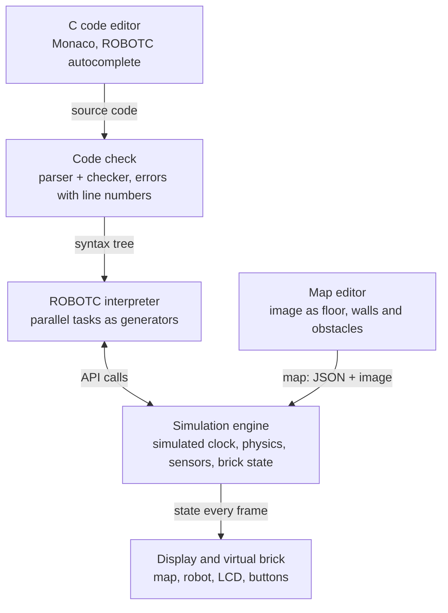

# Requirements – EV3 Simulator in C

Updated: October 24, 2026 · Original online document: https://claude.ai/artifact/EoMcwkSBSLBBd3awzJ9BiL

## Goal and scope

The system lets you write a C program against the LEGO EV3 API and run it on a virtual robot inside a map, without a physical robot. Code is written in the ROBOTC dialect, so existing ROBOTC programs run in the simulator unchanged.

**Audience:** robotics students and teachers, competition teams (such as FLL), and developers without a robot at hand.

**Chosen API:** ROBOTC for LEGO MINDSTORMS EV3 (version 4.x). It is a C dialect with additions: `task main()`, hardware setup with `#pragma config`, and functions such as `getColorName()` and `setMotorSpeed()`. ROBOTC has been discontinued, so the simulator is the main place to run the code. Other interfaces (c4ev3, Python, blocks) are out of scope for version 1.

**Out of scope for version 1:**

- Connecting to a physical robot and downloading code to it (the code file can only be exported)
- Building a robot at the level of beams and pins in 3D (instead there is a top-view robot builder, see Requirement 4)
- Full 3D physics simulation

## Requirement 1: Writing code in ROBOTC

The user writes code as in the original ROBOTC environment, including `task main()` and `#pragma config`, runs it with one click, and sees errors marked in the editor.

### Editor and compilation

| ID | Requirement | Priority |
| --- | --- | --- |
| E-1 | Code editor with ROBOTC syntax highlighting, line numbers, and undo/redo | MVP |
| E-2 | Autocomplete for ROBOTC functions and constants (`getColorName`, `motorB`, `S1`, `colorRed`), with the signature and a short description on hover | Version 1 |
| E-3 | Compile when "Run" is clicked; errors and warnings are shown on the correct line of the original code | MVP |
| E-4 | Multiple files per project with `#include` | Version 1 |
| E-5 | Save and load projects; export and import ROBOTC `.c` files and ZIP | MVP |
| E-6 | Ready-made starter templates (drive straight, line following, obstacle avoidance) | Version 1 |
| E-7 | A Debug Stream window that shows the output of `writeDebugStreamLine` | MVP |
| E-8 | A motors and sensors setup screen (like ROBOTC's Motors and Sensors Setup) that writes the `#pragma config` lines automatically | Version 1 |

### ROBOTC dialect support

The code is translated to standard C before compilation. The user does not see this step.

| ID | Requirement | Priority |
| --- | --- | --- |
| L-1 | `task main()` as the entry point | MVP |
| L-2 | `#pragma config(Sensor, ...)` and `#pragma config(Motor, ...)` set the robot configuration in the simulation: which sensor is on each port, names, and reversed motors | MVP |
| L-3 | Parallel tasks: `task`, `startTask`, `stopTask`, `abortTimeslice` | Version 1 |
| L-4 | ROBOTC types such as `string`, `ubyte`, `word`, and built-in constants (`motorA`–`motorD`, `S1`–`S4`, `colorRed`) without `#include` | MVP |
| L-5 | The older style of system arrays: `motor[motorB] = 50`, `SensorValue[S1]`, `nMotorEncoder[motorB]` | Version 1 |

### ROBOTC for EV3 API coverage

Every function must keep the ROBOTC name, signature and behavior. A function that is not implemented yet gives a clear compile error, not silent behavior.

| Area | Example functions | Priority |
| --- | --- | --- |
| Motors | `setMotorSpeed`, `setMotorTarget`, `moveMotorTarget`, `waitUntilMotorStop`, `getMotorEncoder`, `resetMotorEncoder`, `stopMotor`, `stopAllMotors` | MVP |
| Motor sync | `setMotorSync`, `setMotorSyncEncoder`, `setMotorSyncTime` | Version 1 |
| Color sensor | `getColorName`, `getColorReflected`, `getColorAmbient`, `getColorRGB` | MVP |
| Gyro | `getGyroDegrees`, `getGyroRate`, `resetGyro` | MVP |
| Ultrasonic | `getUSDistance` | MVP |
| Touch | `getTouchValue`, `getBumpedValue` | MVP |
| Infrared | `getIRDistance`, `getIRBeaconDirection`, `getIRRemoteButtons` (including a virtual remote) | Version 1 |
| Brick display (178×128) | `displayTextLine`, `displayBigTextLine`, `eraseDisplay` (MVP); lines, circles and pixels (version 1) | MVP |
| Buttons and lights | `getButtonPress`, `waitForButtonPress`, `setLEDColor` | MVP |
| Sounds | `playTone`, `playSound`, `setSoundVolume` | Version 1 |
| Time | `sleep`, `wait1Msec`, `clearTimer`, `time1[T1]`, `nSysTime` | MVP |
| Debugging | `writeDebugStream`, `writeDebugStreamLine` | MVP |
| Math and strings | `abs`, `sqrt`, `sin`, `sprintf`, `strcat` | MVP |
| Files and Bluetooth | Reading/writing files on the brick, communication between robots | Later |

This list was written from memory and has not yet been checked against the documentation. The exact names will be confirmed against the ROBOTC 4.x documentation, and the full API specification will be tracked as a checklist (function → implemented / verified).

## Requirement 2: Simulating a virtual robot

The simulator runs the compiled program on a virtual robot in top view (2D), on a simulated clock that the simulator controls. So `sleep(1000)` equals exactly one second of simulation, even when running faster or slower.

### Running and control

| ID | Requirement | Priority |
| --- | --- | --- |
| S-1 | Run, Stop and Reset buttons. Reset puts the robot back at the start point set in the map | MVP |
| S-2 | Simulation speed from ×0.25 to ×4, and a step-by-step mode | Version 1 |
| S-3 | An infinite loop or a crash in the program does not freeze the interface. Stop always works | MVP |
| S-4 | A crash (invalid memory access, division by zero) is shown as a clear message, with a line number when possible | Version 1 |
| S-5 | The simulation is deterministic: the same code, map and noise seed give the same result | Version 1 |

### The virtual robot

| ID | Requirement | Priority |
| --- | --- | --- |
| R-1 | A default Educator-style robot: two large motors on B and C, a free support wheel | MVP |
| R-2 | Configuration: wheel diameter, distance between the wheels, and the position and direction of each sensor on the robot. **Replaced by Requirement 4:** the configuration comes from the robot that was built | MVP |
| R-3 | A medium motor on A or D for an arm or gripper, with its angle shown | Version 1 |
| R-4 | Save a robot configuration as a file and reuse it in different projects (see B-12) | Version 1 |

### Physics and sensors

| ID | Requirement | Priority |
| --- | --- | --- |
| P-1 | Motors with a reasonable maximum speed, acceleration and braking, and a rotation counter in degrees | MVP |
| P-2 | The robot's motion comes from the speeds of its two wheels (differential drive) | MVP |
| P-3 | Collisions with walls and obstacles: the robot stops and does not pass through them | MVP |
| P-4 | Movable objects (boxes, balls) that the robot pushes | Version 1 |
| P-5 | The color sensor samples the map pixels under it (a small round area) and returns reflected light 0–100, one of LEGO's 8 colors, or RGB | MVP |
| P-6 | Ultrasonic: a ray from the sensor to the nearest obstacle, range 3–255 cm, and a narrow cone of view | MVP |
| P-7 | Gyro: angle and turn rate from the robot, with optional drift | MVP |
| P-8 | Touch: pressed when the front of the sensor touches an obstacle | MVP |
| P-9 | Adjustable noise on every sensor and on the motors (off / realistic) | Version 1 |

### Display

| ID | Requirement | Priority |
| --- | --- | --- |
| V-1 | Map view with zoom and scrolling, and a camera that follows the robot | MVP |
| V-2 | Virtual brick: LCD display, six buttons that can be clicked with the mouse, and a status light | MVP |
| V-3 | Live panel of sensor and motor values, with the sensor rays drawn on the map | MVP |
| V-4 | A trail of the robot's path | MVP |

## Requirement 3: Creating maps

A map has two layers: the **floor** (an image the color sensor reads) and **objects** (walls and obstacles that the physics, the ultrasonic sensor and the touch sensor see). Each map is saved as a single file.

| ID | Requirement | Priority |
| --- | --- | --- |
| M-1 | Create a new map with real dimensions in cm (for example the 236×114 cm FLL mat) | MVP |
| M-2 | **Upload an image as the floor** (PNG, JPG): the user sets the real size of the image in cm, and the system calculates the pixels-to-cm ratio | MVP |
| M-3 | Image scale calibration: mark two points and enter the distance between them | Version 1 |
| M-4 | Drawing tools for the floor: line (width and color can be chosen), arc, filled rectangle and circle, eraser | MVP |
| M-5 | Objects: fixed walls and obstacles (rectangle, circle, line) with a height, and movable objects with a mass | MVP: fixed; Version 1: movable |
| M-6 | The map borders are an automatic wall (can be turned off) | MVP |
| M-7 | Set the robot's start point and starting direction by dragging | MVP |
| M-8 | Select, move, rotate, resize and delete objects; undo/redo and snap to grid | MVP |
| M-9 | Ready-made maps: oval line track, maze, color sorting, arena with obstacles | Version 1 |
| M-10 | Save, load, export and import a map as a JSON file (with the image included in the file) | MVP |
| M-11 | Switch quickly from editing a map to running a simulation on it | MVP |
| M-12 | Every obstacle has a height (default 10 cm) and a color, and the border walls also have a height (default 15 cm). A sensor mounted higher than an obstacle does not see it (see Requirement 4) | MVP |

## Requirement 4: Building a robot from LEGO parts

The user builds the robot from real EV3 parts in top view, and the simulation comes directly from what was built. The wheels determine the drive, the parts determine the body shape for collisions, and every sensor is mounted at the position, height and direction chosen for it.

**Assumptions behind this requirement:**

- **The simulation stays 2D.** The robot drives on a flat floor and does not tilt. Height exists only for sensors: every sensor has a height above the floor and a tilt angle (down, forward, up), and obstacles have a height.
- **Building is at the level of main parts, not pins.** Every part sits on a grid of LEGO units (1 unit = 8 mm) and rotates in 90° steps. Sensors can be rotated to any angle.
- **Differential drive only:** two driven wheels on the same axle, each with its own motor. The robot cannot drive without two such wheels.
- **Cables are port assignments.** Each motor gets a port A–D and each sensor a port S1–S4, like plugging a cable into the real brick.
- **Part sizes are approximations** of their real size. Wheel diameters come from LEGO tire sizes.

### Parts catalog

| Part | Top-view size (approx.) | Options |
| --- | --- | --- |
| EV3 brick | 12.8 × 8.8 cm | Required, exactly one |
| Large motor | 9.6 × 2.4 cm | Port A–D |
| Medium motor | 4.8 × 3.2 cm | Port A–D |
| Wheel | Diameter × tire width | Size: 30.4×14, 43.2×22, 56×28, 62.4×20, 68.8×36, 81.6×15 mm. Driven by the motor on a given port, or free |
| Ball caster | 2.4 × 2.4 cm | Free support point |
| Beam (liftarm) | 0.8 cm × number of holes | Length: 3, 5, 7, 9, 11, 13, 15 holes |
| Frame 5×7 | 5.6 × 4.0 cm | — |
| Touch sensor | 4.8 × 2.4 cm | Port, direction, height |
| Color sensor | 3.2 × 2.4 cm | Port, direction, tilt, height |
| Ultrasonic sensor | 4.0 × 6.4 cm | Port, direction, tilt, height |
| Gyro sensor | 2.4 × 2.4 cm | Port, tilt of the measuring axis |
| Infrared sensor | 4.0 × 6.4 cm | Port, direction, tilt, height |

### Builder requirements

| ID | Requirement | Priority |
| --- | --- | --- |
| B-1 | A "Robot builder" tab with a parts catalog, a top-view building area with a grid of LEGO units, and a properties panel for the selected part | MVP |
| B-2 | Add a part by clicking the catalog, move it by dragging with grid snapping, rotate by 90° (button or R key), delete (Delete), and undo/redo | MVP |
| B-3 | Choose the port of a motor (A–D) and of a sensor (S1–S4), with the port shown on the part in the building area | MVP |
| B-4 | Wheel: choose a size from the catalog, and whether it is driven by a motor (on which port) or free | MVP |
| B-5 | Sensor: **direction** in the plane (0°–359°, 0 = forward), **tilt** (-90° down, 0° forward, +90° up, and any value in between), and **height** above the floor in cm. There are shortcuts: "Down", "Forward", "Up" | MVP |
| B-6 | A small side view of the selected sensor that shows its height and tilt direction | MVP |
| B-7 | Live validation, with a clear message for each problem: no brick or more than one, not exactly two driven wheels on the same axle, a wheel driven by a motor that does not exist, two devices on the same port. A (non-blocking) warning when there is no third support point | MVP |
| B-8 | The simulation uses the robot that was built: the diameter of each wheel, the distance between the wheels, the body shape (the outline of all parts) for collisions, and the type and position of every sensor | MVP |
| B-9 | The robot that was built decides the sensor type on each port. `#pragma config` in the code only sets names and measuring modes. If a pragma describes a different sensor than the one on that port, a warning is shown on the pragma line | MVP |
| B-10 | A button that generates the `#pragma config` lines for the robot and puts them at the top of the code, replacing the existing lines | MVP |
| B-11 | Ready-made robots: Educator (the default) and a line-following robot with two color sensors | MVP |
| B-12 | Save and load a robot as a JSON file, and save it automatically in the browser | MVP |
| B-13 | The robot in the simulation view is drawn from the parts that were built, not as a fixed shape | MVP |

### Sensor behavior by direction and mounting

The behavior follows the 3D direction of the sensor, even though the simulation itself is 2D.

| ID | Sensor | Behavior |
| --- | --- | --- |
| O-1 | Color, facing down (tilt -30° to -90°) | Reads the floor where its line of sight meets it. The distance to the floor is height ÷ sin(tilt). Up to 1 cm the reading is full; between 1 and 4 cm the reflected light fades gradually; above 2.5 cm the color is `colorNone`. The sampled area also grows with distance |
| O-2 | Color, facing forward (tilt between -30° and +30°) | Reads the color of an obstacle up to 3 cm in front of it, at the sensor's height. With no obstacle: `colorNone` and low reflected light |
| O-3 | Color, facing up (tilt +30° and above) | `colorNone` and almost no reflected light. High ambient light, as if the sensor sees the ceiling lights |
| O-4 | Ultrasonic and infrared | A 3D ray following the direction and tilt. Facing down, the ray measures the distance to the floor. An obstacle is detected only if the ray meets it at a height between 0 and the obstacle's height. Facing up with no obstacle: 255 |
| O-5 | Touch | Pressed when its tip touches an obstacle taller than the sensor's height, or a wall. The sensor's direction decides where the tip is |
| O-6 | Gyro | Measures turning around the vertical axis, times cos(tilt): upright = normal reading, on its side (90°) = 0, upside down (180°) = reading with the opposite sign |

## Further suggestions

The two most worthwhile suggestions are **missions with automatic scoring** and **live sensor graphs**: they turn the simulator into a learning and training tool, at relatively low cost.

| ID | Suggestion | Why it is worth it | Effort |
| --- | --- | --- | --- |
| X-1 | **Scored missions**: target areas on the map, a time limit, objects to move, and a penalty for collisions | A teacher defines an exercise and the system checks it. Suits FLL training | Medium |
| X-2 | **Live graphs** of sensor values and motor speeds, with CSV export | Essential for tuning a PID controller for line following | Low |
| X-3 | **Recording and replay** of a run, including scrubbing forward and back in time | Shows what the robot "saw" at the moment things went wrong | Medium |
| X-4 | **Export to a real robot**: export a .c file that opens in ROBOTC, and later automatic translation to c4ev3 to run on a robot without ROBOTC | Lets the code run on a real robot even though ROBOTC is discontinued | Medium |
| X-5 | **Manual remote-control mode** from the keyboard, without code | A quick check of a map and of sensor positions | Low |
| X-6 | **Debugger**: breakpoints, line-by-line execution, watching variables, with the simulation paused together with the code | The strongest learning tool, but also the hardest to build | High |
| X-7 | **Automated tests**: run the simulation without display and check that the robot reached its goal | A teacher checks a whole class's work at once | Medium |
| X-8 | **Hebrew and English interface** (RTL), with the editor itself staying LTR | Accessible to young students in Israel | Low |
| X-9 | **Several robots on the same map** (competitions, sumo) | Motivation and competitions in class | High |

## Proposed architecture

A web app that runs the ROBOTC code in the browser using an interpreter written in TypeScript. The simulation engine controls time, and user code runs in an isolated place.

**Decision (October 23, 2026):** an interpreter instead of compiling to WebAssembly. No compiler needs to be installed, parallel tasks and `sleep` are simple to implement, and a debugger is easy to add later. The downside: only partial C support (no pointers or structs, and most of the standard library is not supported).

Each task runs as a generator that pauses after every statement. In every simulated millisecond, the scheduler lets each task run up to 100 statements. A call like `sleep(1000)` waits one simulated second, not one real second.

| Component | Proposed technology |
| --- | --- |
| Interface | React + TypeScript |
| Code editor | Monaco Editor |
| Running code | ROBOTC interpreter in TypeScript (lexer, parser, checker, interpreter) |
| Physics | Our own 2D model: differential drive and collisions |
| Display | Canvas |
| Storage | IndexedDB in the browser, export to files |

## Non-functional requirements

| ID | Requirement |
| --- | --- |
| N-1 | Runs in current versions of Chrome, Edge and Firefox on Windows, Mac and Linux |
| N-2 | Compiling a typical program (up to 500 lines) takes less than 3 seconds |
| N-3 | Display at 60 frames per second, and a fixed physics step of 1–5 ms regardless of computer speed |
| N-4 | User code runs in an isolated environment (WebAssembly) and cannot access the computer's files or network |
| N-5 | Works offline after the first load (with in-browser compilation) |
| N-6 | Modular code: the API layer is separate from the simulator, so Python or blocks can be added later |

## Development phases

1. **MVP:** code editor, compilation, a robot with two motors, color, gyro, ultrasonic and touch sensors, brick display and buttons, and a map editor with image upload. This is everything marked MVP in the tables.
2. **Version 1:** full coverage of the listed API, movable objects, sensor noise, ready-made maps, and suggestions X-1, X-2 and X-5.
3. **Later:** debugger, export to a real robot, several robots on one map, 3D view.

## Open questions

- [ ] Where does compilation happen: on a local server (simple and quick to build) or in the browser (no installation, but a heavy first download)?
- [ ] A single user on one computer, or a class with accounts, cloud storage and shared maps?
- [ ] Are there existing ROBOTC programs that can be used as compatibility tests? And is the full ROBOTC 4.x for EV3 documentation available?
- [ ] Will the system be open source, and under which license?
